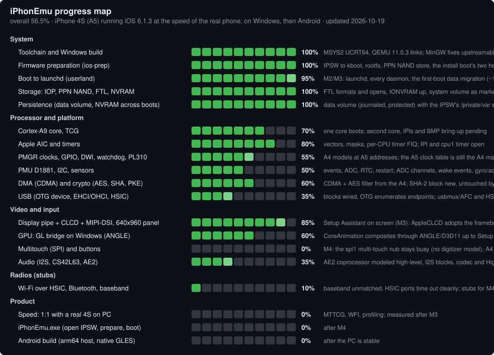

# iPhonEmu

An emulator for the **iPhone 4S (iPhone4,1, n94ap, Apple A5 / S5L8940X)** running **iOS 6.1.3
(10B329)**, for Windows first and Android after it, built on QEMU. The target is the speed of a real
4S: two Cortex-A9 cores through QEMU's multi-threaded TCG and the guest's OpenGL ES executed on the
host GPU.

This repository is a fork of [samhenrigold/qemu-ios](https://github.com/samhenrigold/qemu-ios) (the
emulator inside Light Touch), which is itself a fork of [QEMU](https://www.qemu.org/). Its history is
kept in full so that upstream work can be merged and credited. The S5L8900 / iPhone 3G interpreter
that this project started as lives on the `s5lbox-3g` branch.

## Status

<!-- progress:start -->
  

[](docs/progress/progress.json)

Milestones: ✅ M1 serial console · ✅ M2 launchd and daemons · ⬜ M3 Setup / lock screen · ⬜ M4 home screen and apps. History: `docs/progress/history.md`. Figures are estimates of work done toward the
goal, weighted by effort (`docs/progress/progress.json`); `tools/dev/progress_map.py` regenerates this block.

| Area | Progress | |
|---|---|---|
| System: Toolchain and Windows build | 🟩🟩🟩🟩🟩🟩🟩🟩🟩🟩 | 100% |
| System: Firmware preparation (ios-prep) | 🟩🟩🟩🟩🟩🟩🟩🟩🟩🟨 | 95% |
| System: Boot to launchd (userland) | 🟩🟩🟩🟩🟩🟩🟩🟩⬜⬜ | 80% |
| System: Storage: IOP, PPN NAND, FTL, NVRAM | 🟩🟩🟩🟩🟩🟩🟩🟩🟨⬜ | 85% |
| System: Persistence (data volume, NVRAM across boots) | 🟩🟩🟩🟩🟩🟨⬜⬜⬜⬜ | 55% |
| Processor and platform: Cortex-A9 core, TCG | 🟩🟩🟩🟩🟩🟩🟩⬜⬜⬜ | 70% |
| Processor and platform: Apple AIC and timers | 🟩🟩🟩🟩🟩🟩🟩🟩⬜⬜ | 80% |
| Processor and platform: PMGR clocks, GPIO, DWI, watchdog, PL310 | 🟩🟩🟩🟩🟩🟨⬜⬜⬜⬜ | 55% |
| Processor and platform: PMU D1881, I2C, sensors | 🟩🟩🟩🟩🟩⬜⬜⬜⬜⬜ | 50% |
| Processor and platform: DMA (CDMA) and crypto (AES, SHA, PKE) | 🟩🟩🟩🟩🟩🟩⬜⬜⬜⬜ | 60% |
| Processor and platform: USB (OTG device, EHCI/OHCI, HSIC) | 🟩🟩🟩🟨⬜⬜⬜⬜⬜⬜ | 35% |
| Video and input: Display pipe + CLCD + MIPI-DSI, 640x960 panel | 🟨⬜⬜⬜⬜⬜⬜⬜⬜⬜ | 5% |
| Video and input: GPU: GL bridge on Windows (ANGLE) | ⬜⬜⬜⬜⬜⬜⬜⬜⬜⬜ | 0% |
| Video and input: Multitouch (SPI) and buttons | ⬜⬜⬜⬜⬜⬜⬜⬜⬜⬜ | 0% |
| Video and input: Audio (I2S, CS42L63, AE2) | ⬜⬜⬜⬜⬜⬜⬜⬜⬜⬜ | 0% |
| Radios (stubs): Wi-Fi over HSIC, Bluetooth, baseband | 🟩⬜⬜⬜⬜⬜⬜⬜⬜⬜ | 10% |
| Product: Speed: 1:1 with a real 4S on PC | ⬜⬜⬜⬜⬜⬜⬜⬜⬜⬜ | 0% |
| Product: iPhonEmu.exe (open IPSW, prepare, boot) | ⬜⬜⬜⬜⬜⬜⬜⬜⬜⬜ | 0% |
| Product: Android build (arm64 host, native GLES) | ⬜⬜⬜⬜⬜⬜⬜⬜⬜⬜ | 0% |
<!-- progress:end -->

| Phase | Goal | State |
|---|---|---|
| 0 | Repository on the qemu-ios fork, Windows build of `qemu-system-arm` (MSYS2 UCRT64) | done 2026-10-16: QEMU 11.0.3 builds and lists the eight qemu-ios machines |
| 1 | `tools/ios-prep`: IPSW to kernel bundle (kernel, device tree, rootfs); A5 hardware inventory | done: `kboot.bin` builds, inventory in `docs/n94/` |
| 2 | `-M iPhone-4S` skeleton: Cortex-A9, 512 MiB at 0x80000000, Apple AIC, timers, UART. **M1:** kernel console on the serial port | not started |
| 3 | Platform bring-up to `launchd` (**M2**) | not started |
| 4 | Display pipe at 640x960 and the GL bridge (**M3:** Setup or lock screen) | not started |
| 5 | Touch, buttons, PMU, audio, radio stubs (**M4:** home screen and apps) | not started |
| 6 | 1:1 speed on the PC (MTTCG, WFI, profiling) | not started |
| 7 | `iPhonEmu.exe`: open an IPSW, prepare, boot | not started |
| 8 | Android (arm64 host, native GLES) | not started |

Board documentation is in `docs/n94/` (`README.md` for how to boot, `hardware.md` for the A5 as the
iOS 6.1.3 device tree and kernelcache describe it). The A4 machines this work starts from are
documented in `docs/n90/`, `docs/n81/` and `docs/ipad1/`.

## Preparing firmware

Nothing from Apple is in this repository. You supply the IPSW; the decryption keys are published per
build on [The Apple Wiki](https://theapplewiki.com/wiki/Keys:BrightonMaps_10B329_(iPhone4,1)) and
`tools/ios-prep` fetches and caches them (or takes `--keys your.json`).

```
python tools/ios-prep/ios_prep.py prepare iPhone4,1_6.1.3_10B329_Restore.ipsw --out firmware/n94_10B329
```

writes `kernelcache.mach`, `DeviceTree.bin`, `iBoot.bin`, the expanded HFS+ root filesystem
`rootfs.hfs`, the direct-kernel boot bundle `kboot.bin` (the K48KBOOT format the A4 machines boot,
see `hw/arm/ipad1.c`), and the inventory (`devicetree.txt`, `kexts.txt`, `iomap.tsv`). Python 3 and
the `cryptography` package are the only requirements; it runs on Windows.

## Building

QEMU's build system is unchanged. On Windows use MSYS2's UCRT64 environment (a portable one in a
folder works: extract `msys2-base-x86_64-*.sfx.exe`, `pacman -Syuu`, then the `mingw-w64-ucrt-x86_64-`
packages `toolchain glib2 pixman SDL2 SDL2_image libslirp ninja meson python pkgconf zlib zstd lzo2
snappy libjpeg-turbo libpng curl gnutls nettle dtc capstone angleproject libusb ffmpeg`). The fork's
PKE/AES models link OpenSSL, so pass it explicitly:

```
mkdir build && cd build
../configure --target-list=arm-softmmu --enable-sdl --disable-werror --disable-docs \
    --disable-guest-agent --extra-ldflags=-lcrypto
ninja qemu-system-arm.exe
```

`build/qemu-system-arm.exe -M help` then lists the qemu-ios boards. Developer Mode is not needed:
the install bundle falls back to copies where Windows refuses symbolic links. `RUNNING.md` and the
upstream README (`docs/qemu-ios-README.md`) describe the macOS build and the other boards.

## Credits

- [QEMU](https://www.qemu.org/) and its contributors: the machine emulator, TCG and the device model
  framework everything here runs on.
- [samhenrigold/qemu-ios](https://github.com/samhenrigold/qemu-ios) and
  [Light Touch](https://github.com/samhenrigold/LightTouchMac): the S5L8900/8720/8920/8930 boards,
  the kboot direct-kernel boot path, the host GL bridge (`hw/arm/gles-host*.c`, `contrib/gles-public`),
  the guest services and the baseband model. The kboot builder in `tools/ios-prep/kboot.py` is a port
  of FirmwareKit's `KBoot.swift`.
- [devos50/qemu-ios](https://github.com/devos50/qemu-ios): the original iPod touch emulation work.
- [The Apple Wiki](https://theapplewiki.com/): firmware keys and device documentation.
- [n94linux](https://github.com/n94linux) and the Linux `apple-aic` driver: the public A5 addresses
  (DRAM at 0x80000000, AIC at 0x3F200000, the 24 MHz timebase).

## License

GPL-2.0, as QEMU: see `COPYING`. Files under `COPYING.LIB` (LGPL-2.1) and other compatible licenses
keep their own headers. The `s5lbox-3g` branch keeps its MIT notices.
